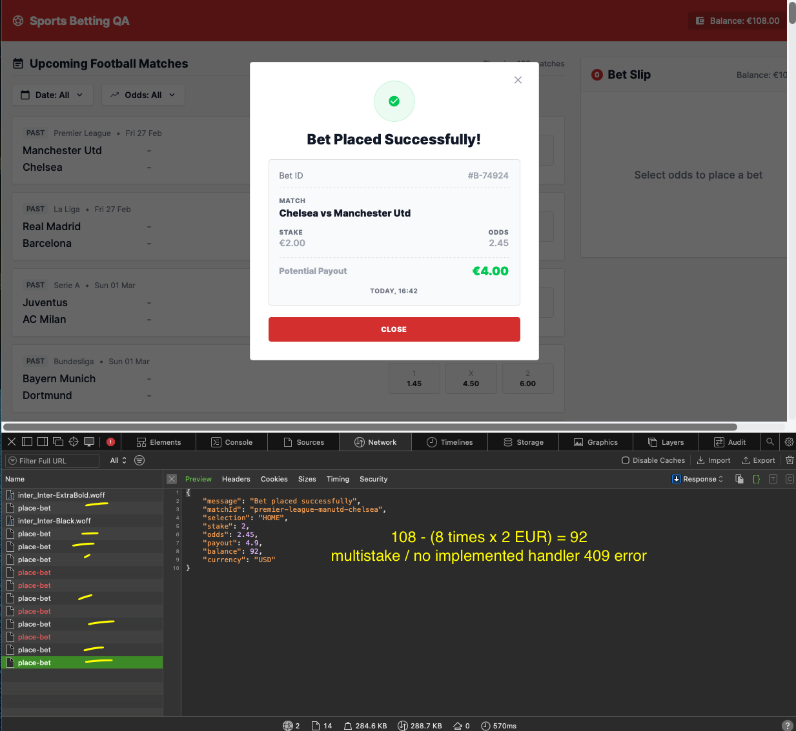
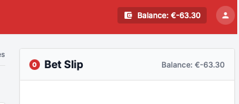
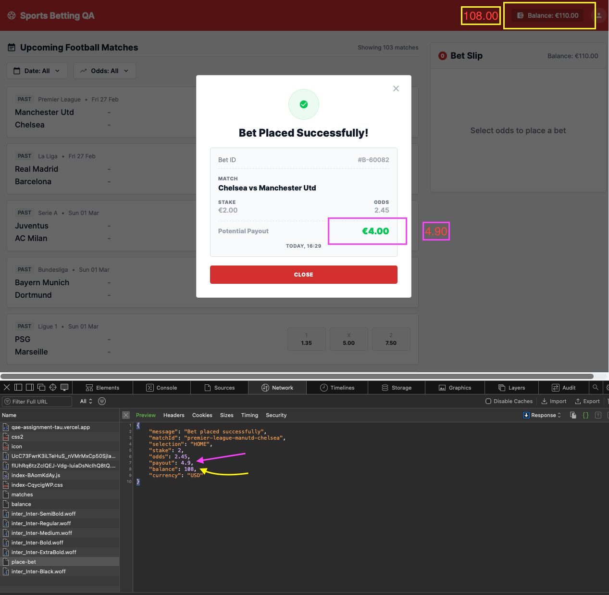
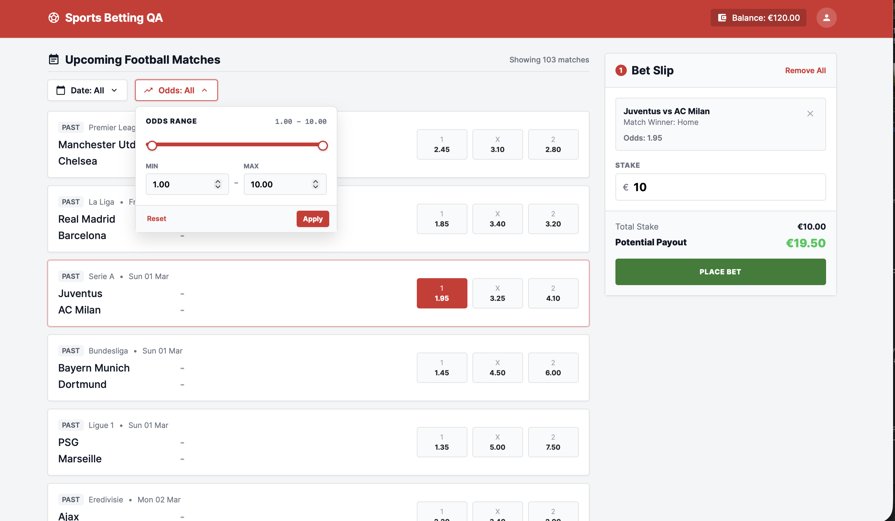
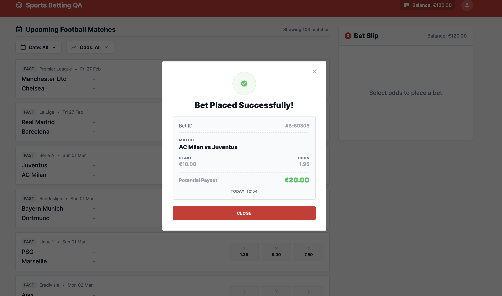

# Test Results and Bug Reports — Single Bet Placement

Results of executing the three highest-priority scenarios from `TEST_PLAN.md` (TC-01 to TC-03), plus exploratory checks around the bet placement flow.

---

## 1. Document Information

| Field | Value |
|---|---|
| Feature | Single Bet Placement |
| Related document | `TEST_PLAN.md` |
| Application | `https://qae-assignment-tau.vercel.app/?user-id=<your-user-id>` |
| Tester | `<your name>` |
| Execution date | 2026-10-09 |
| Status | Fail — not ready for release |

---

## 2. Test Environment

| Item | Value |
|---|---|
| Platform | macOS, desktop |
| Browser | Safari with Web Inspector (used for the Network evidence). **Re-verify in the latest desktop Chrome before submitting; the assignment specifies Chrome.** |
| API tools | Browser Network tab, Swagger UI (`/api/docs`) |
| Test data | Balance restored with `POST /api/reset-balance`; match `premier-league-manutd-chelsea` (Home odds 2.45) and Juventus vs AC Milan (Home odds 1.95) |

---

## 3. Execution Summary

| Metric | Result |
|---|---|
| Scenarios executed | 3 |
| Passed | 0 |
| Failed | 3 |
| Bugs reported | 4 (2 Critical, 2 High) |
| Additional findings (section 7) | 3 |

All three top scenarios fail. The two Critical bugs let a user lose money without noticing (repeated charges and a negative balance), and in the executed runs the receipt payout and the on-screen balance were wrong after successful bets.

---

## 4. Executed Scenarios

| ID | Scenario | Priority | Result | Linked bugs |
|---|---|---|---|---|
| TC-01 | Place a valid bet and verify slip, receipt and balance | Critical | Fail | BUG-03, BUG-04, A-1 |
| TC-02 | Stake above the available balance is blocked | Critical | Fail | BUG-02 |
| TC-03 | Rapid repeated Place Bet creates only one bet | Critical | Fail | BUG-01 |

---

## 5. Severity Guide

| Severity | Meaning |
|---|---|
| Critical | Money is charged or lost incorrectly, or a core business rule is not enforced |
| High | Money or bet details are shown incorrectly, or an important flow is broken |
| Medium | A secondary flow or data field is wrong with limited impact |
| Low | Minor visual or copy issue |

---

## 6. Bug Reports

### BUG-01 — Rapid repeated clicks on Place Bet submit several bets and debit the stake each time

| Field | Value |
|---|---|
| Severity | **Critical** |
| Linked scenario | TC-03 |
| Violated requirement | "Only one bet can be active at a time" (Domain Context); one final outcome per submit (spec 2.3); `409` bet already in progress (spec 5.3) |

**Reproduction steps**

1. Open the app and note the header balance (€108.00 in the evidence run).
2. Open DevTools → Network and filter on `place-bet`.
3. Select the Home odds of Manchester Utd vs Chelsea (2.45) and enter stake `2.00`.
4. Click **Place Bet** as fast as possible, 8–10 times.
5. Count the `place-bet` requests and read the `balance` field of the last response.
6. Close the receipt and compare the displayed balance with the response.

**Expected result**

- The button is disabled after the first click (`Placing...`) and only one request is sent.
- Any extra request that reaches the API is rejected with `409` and does not change the balance.
- One receipt is shown and the balance becomes €106.00 (108.00 − 2.00).

**Actual result**

- 12 `place-bet` requests were sent. 8 of them succeeded and each debited €2.00: the last response returns `"balance": 92`, which is 108 − 8 × 2.
- The other 4 requests are marked as failed (red) in the Network tab, but the UI shows no error. Only one receipt (`#B-74924`) is shown and the header still displays €108.00.

**Business impact:** A user who double-clicks, or whose connection is slow, is silently charged several times for one intended bet and sees a single receipt, which means direct money loss, support disputes and complaints.

**Evidence:** `/bugs_screenshots/multibet.png`

**Notes:** The status codes of the red requests are not readable in the screenshot; confirm they are `409` in the Network tab. The UI does not block repeated submits, and the backend "bet in progress" guard rejected only some of the simultaneous requests, so it is not applied reliably.

---

### BUG-02 — User can bet more than the available balance and the balance goes negative

| Field | Value |
|---|---|
| Severity | **Critical** |
| Linked scenario | TC-02 |
| Violated requirement | Stake "cannot exceed the user's current balance" (Domain Context); validation 4.1 "Must not exceed available balance" for UI and API; UI copy "Insufficient balance" (4.4) |

**Reproduction steps**

1. Reset the balance (€125.50).
2. Place a bet with stake `100.00`. The remaining balance is €25.50.
3. Select odds again and enter a stake inside the €1.00–€100.00 limits but above the balance, for example `60.00`.
4. Note the warning and the Place Bet state, then click **Place Bet**.
5. Read the header balance, the bet slip balance and `GET /api/balance`.

**Expected result**

- The UI shows **Insufficient balance** and blocks Place Bet; the API rejects the same stake with `422`.
- No receipt is shown and the balance stays €25.50. The balance never goes below zero.

**Actual result**

- The bet is accepted and the balance becomes negative: the header and the bet slip both show **€-63.30**.

**Business impact:** The operator effectively lends money for free: a user can keep betting with funds they do not have and the platform carries the loss.

**Evidence:** `bugs_screenshots/overdraft.png`

**Notes:** The header balance is read from the API, so the server-side balance is most likely negative and the API accepted the stake; confirm with `GET /api/balance`. The exact stake sequence behind the €-63.30 in the screenshot was not recorded; the steps above are the generic sequence for TC-02. The same state may also be reachable through BUG-01, since the balance check seems to run before the debit of earlier simultaneous requests.

---

### BUG-03 — Bet receipt shows a wrong Potential Payout that does not equal stake × odds

| Field | Value |
|---|---|
| Severity | **High** |
| Linked scenario | TC-01 |
| Violated requirement | Payout = stake × odds, for example €10 at 2.45 returns €24.50 (Domain Context); receipt values consistent with what was shown before placement (2.4) |

**Reproduction steps**

1. Open the app and select the Home odds `2.45` of Manchester Utd vs Chelsea.
2. Enter stake `2.00` and note the Potential Payout in the bet slip.
3. Click **Place Bet**.
4. Compare the Potential Payout in the receipt with the `payout` field of the `place-bet` response.

**Expected result**

- Receipt payout = 2.00 × 2.45 = **€4.90**, equal to the slip and to the API response.

**Actual result**

- The receipt shows **€4.00**, while the API response contains `"payout": 4.9`, which is correct.
- Second observation: stake `10.00` at odds 1.95 shows €19.50 in the bet slip but **€20.00** in the receipt.
- In both cases the receipt payout equals exactly 2 × stake.

**Business impact:** The user is told the wrong amount a winning bet returns (€0.90 less in the first case, €0.50 more in the second), which creates disputes and destroys trust in the receipt.

**Evidence:** `bugs_screenshots/miscalculation.png`, `bugs_screenshots/bet-slip-payout.png`, `bugs_screenshots/receipt-payout.png`

**Notes:** This is not expected behaviour: the specification defines payout as stake × odds and the API calculates it correctly, so the defect is in the receipt calculation in the UI. A payout of 2 × stake for two different odds values points to either a fixed multiplier or odds rounded to a whole number (2.45 and 1.95 both round to 2). Checking odds such as `3.20` would tell the two causes apart.

---

### BUG-04 — Balance in the header and the bet slip is not updated after a bet until the page is reloaded

| Field | Value |
|---|---|
| Severity | **High** |
| Linked scenarios | TC-01, TC-03 |
| Violated requirement | On success the stake is deducted (2.3); the balance is shared between the header and the bet slip (Domain Context) |

**Reproduction steps**

1. Open the app and note the header balance (€110.00 in the evidence run).
2. Place a bet with stake `2.00`.
3. Without reloading, read the balance in the header and in the bet slip.
4. Compare it with the `balance` field of the `place-bet` response.
5. Reload the page and read the balance again.

**Expected result**

- Header and bet slip show €108.00 immediately after the successful bet, equal to the API response.

**Actual result**

- Header and bet slip still show **€110.00**, while the response returns `"balance": 108`. The displayed balance changes only after a page reload.
- In the rapid-click run (BUG-01) the header shows €108.00 while the server balance is 92.

**Business impact:** Users decide what they can afford from a wrong balance, which makes BUG-01 and BUG-02 easier to hit and leads to confusion and complaints.

**Evidence:** `bugs_screenshots/miscalculation.png` (header 110.00, response 108), `bugs_screenshots/multibet.png` (header 108.00, response 92)

**Notes:** The reload step comes from the tester's observation during execution; it is not captured in the screenshots.

---

## 7. Additional Findings from Exploratory Checks

Visible in the evidence while executing the scenarios. They are listed here and not written up in full.

| ID | Finding | Evidence | Suggested severity |
|---|---|---|---|
| A-1 | The receipt lists the teams in reverse order: the match id is `premier-league-manutd-chelsea` and the list shows Manchester Utd first, but the receipt reads "Chelsea vs Manchester Utd". The spec says the home team always comes first, including on the receipt. | `multibet.png`, `miscalculation.png` | High |
| A-2 | Bets are accepted on a match that carries the `PAST` badge (the Premier League card dated Fri 27 Feb, odds 2.45, which matches the bets above). The spec allows upcoming events only and the heading reads "Upcoming Football Matches". | `multibet.png` | Critical |
| A-3 | The `place-bet` response returns `"currency": "USD"`; the spec requires `EUR` (Business Rules and API section). The UI shows € everywhere, so users do not see it. | `multibet.png`, `miscalculation.png` | Medium |

---

## 8. Conclusion

**Result: Fail.** None of the three highest-priority scenarios passed. The feature charges users incorrectly (BUG-01), allows a negative balance (BUG-02), and shows wrong money values after every bet (BUG-03, BUG-04), so it should not be released. The first fixes should be an atomic balance check and debit with a single-bet guard on the backend, a disabled Place Bet button while a request is in flight, and a balance refresh after each response.
